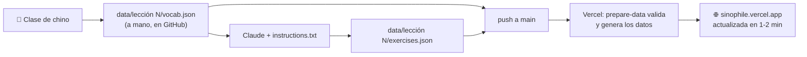
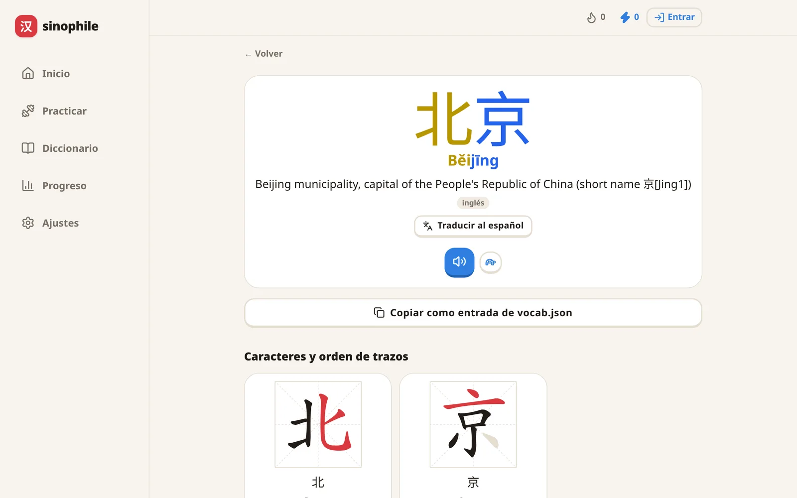
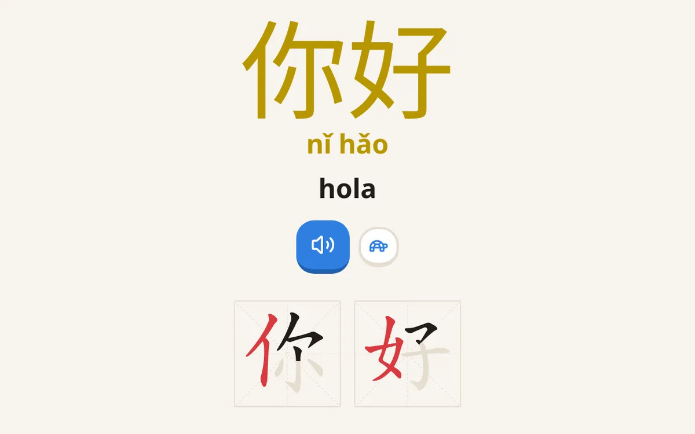
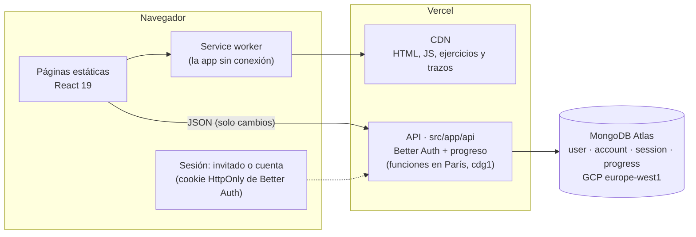
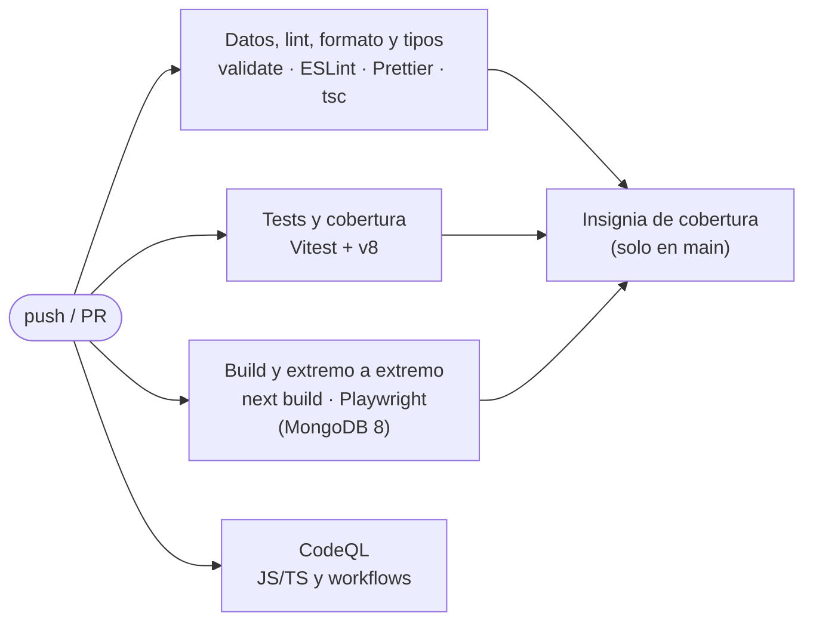

<div align="center">


# sinophile 汉

**App web para estudiar el vocabulario de chino mandarín que aprendo en clase**, al estilo de Duolingo
y Trainchinese.

[](https://github.com/Pablo-Caballero-Maria/sinophile/actions/workflows/ci.yml)
[](https://github.com/Pablo-Caballero-Maria/sinophile/actions/workflows/codeql.yml)
[](https://github.com/Pablo-Caballero-Maria/sinophile/actions/workflows/ci.yml)
[](https://github.com/Pablo-Caballero-Maria/sinophile/releases)
[](LICENSE)
[](https://sinophile.vercel.app)


[**Abrir la app**](https://sinophile.vercel.app) ·
[Wiki](https://github.com/Pablo-Caballero-Maria/sinophile/wiki) ·
[Registro de cambios](CHANGELOG.md) ·
[Resumen en mi portfolio](https://pablo-caballero.vercel.app/projects/sinophile)


</div>

Next.js desplegada en Vercel en cada _push_ a `main`: las páginas son estáticas, funcionan sin conexión
(_service worker_) y una pequeña API con [Better Auth](https://www.better-auth.com) guarda las cuentas y
el progreso en MongoDB Atlas. Cada respuesta lleva una política de seguridad de contenidos (CSP) y las
demás cabeceras de seguridad, y el Firewall de Vercel vigila el tráfico.

> [!TIP]
> No hace falta cuenta para probarla: el **modo invitado** permite usarlo todo, aunque al cerrar la app
> no se guarda nada.

| 📚 Lecciones | 🈶 Palabras | ✍️ Tipos de ejercicio |        📖 Diccionario        | ⏱️ De la clase a la web |
| :----------: | :---------: | :-------------------: | :--------------------------: | :---------------------: |
|      7       |     205     |       más de 12       | CC-CEDICT (108 563 entradas) |         1-2 min         |

## Índice

- [Flujo diario](#flujo-diario)
- [Funcionalidades](#funcionalidades)
- [Cómo está hecha](#cómo-está-hecha)
- [Datos (`data/`)](#datos-data)
- [Cuentas y progreso](#cuentas-y-progreso)
- [Desarrollo](#desarrollo)
- [Calidad e integración continua](#calidad-e-integración-continua)
- [Estructura](#estructura)
- [Documentación](#documentación)
- [Contribuir](#contribuir)
- [Cómo citar](#cómo-citar)
- [Licencia y créditos](#licencia-y-créditos)

## Flujo diario



1. Después de clase creo en GitHub la carpeta de esa clase, **`data/lección N/`** (`lección 1`,
   `lección 2`…), con su **`vocab.json`**:

   ```json
   [{ "id": "ni-hao", "hanzi": "你好", "pinyin": "nǐ hǎo", "es": "hola" }]
   ```

   Cada carpeta es una lección; el número del nombre marca el orden. Los `id` no se pueden repetir entre
   clases (solo letras sin tildes, números, `-` y `_`). Las palabras ya se pueden practicar con los
   ejercicios automáticos.

2. Le paso a Claude `instructions.txt`, el `vocab.json` de la clase nueva y los de las anteriores, y le
   pido el `exercises.json` de esa clase.
3. Lo guardo en **`data/lección N/exercises.json`**. En 1-2 minutos la web está actualizada.

> [!NOTE]
> Si algún JSON tiene errores, la app ignora lo inválido y lo muestra en **Ajustes → Estado de los
> datos**. Si el JSON ni siquiera es válido, el build falla y Vercel mantiene la versión anterior.

## Funcionalidades

- **Lecciones** con introducción de palabras nuevas, **repetición espaciada** (cajas de Leitner por
  palabra × destreza), repaso inteligente, modo infinito (3 vidas), exámenes con nota de 0 a 10 y
  tarjetas.
- **Tarjetas** (_flashcards_) que empiezan por la cara que elijas: la palabra en español (detrás, el
  hanzi, el pinyin y el botón de pronunciación), el hanzi, el pinyin o su sonido (detrás, el resto), o
  una mezcla. La de sonido no se ofrece en modo silencioso.
- **Ejercicios**: significado, español→chino, escucha, dictado de frases, pinyin y tonos (elegir y
  escribir), emparejar, rellenar huecos, traducir con fichas en ambas direcciones, diálogos, preguntas,
  pronunciación (reconocimiento de voz o grabación + comparación) y escritura de hanzi:
  - **guiada**, con el orden de trazos de Hanzi Writer;
  - **libre**, pensada para iPad + Apple Pencil: ves la palabra en español, la dibujas en un lienzo en
    blanco y se revela el hanzi, sin corrección, con la opción de repetirla o pasar a la siguiente; da XP
    pero no cuenta para la precisión ni para la repetición espaciada. La escritura de memoria de los
    exámenes sí se corrige trazo a trazo, porque el examen necesita una nota.
- **Modo silencioso**, para practicar rodeado de gente: una casilla en Inicio, Practicar y cada lección
  (también en Ajustes → Audio y voz) que quita los ejercicios de escucha y de pronunciación y apaga todos
  los sonidos. Los modos Escucha y Pronunciación desaparecen mientras está marcada, y se guarda con los
  ajustes de la cuenta.
- **Tu vocabulario** (en Inicio): cuántas palabras conoces, cuántas de ellas son del **HSK 2 del HSK
  3.0** y qué parte conoces ya, con la lista de sus 500 palabras (las 300 del nivel 1 y las 200 del nivel
  2 del temario de 2025), por nivel y filtrada (todas, conocidas o por aprender). Una palabra cuenta como
  conocida si está en tus lecciones o dentro de otra que conoces (书 en 本书, 月 en 一月; 杯 cuenta por
  杯子); las que se escriben igual (点, 花, 过) muestran su categoría gramatical.
- **Gamificación**: XP, niveles, racha diaria, meta diaria, combos, logros, estrellas por lección y
  récords.
- **Diccionario** (tu vocabulario + CC-CEDICT) con búsqueda por hanzi, pinyin con o sin tonos, español o
  inglés; traductor español ⇄ chino; ficha de palabra con trazos animados, ejemplos y dominio por
  destreza.
- **Colores por tono**, voz china (TTS del navegador), tema claro (por defecto) u oscuro (el botón de la
  barra superior o Ajustes → Apariencia) y diseño para móvil e iPad.
- **Funciona sin conexión**: tras la primera visita, un _service worker_ guarda la app entera (páginas,
  lecciones, ejercicios y trazos) y se puede practicar sin internet; el diccionario general se guarda la
  primera vez que se usa. Mientras algo carga se ve su esqueleto (_skeleton loader_), no un hueco.

| Tono    |   1.º   |   2.º    |     3.º     |   4.º   | neutro  |
| ------- | :-----: | :------: | :---------: | :-----: | :-----: |
| Color   | 🔵 azul | 🟢 verde | 🟡 amarillo | 🔴 rojo | ⚪ gris |
| Ejemplo |   mā    |    má    |     mǎ      |   mà    |   ma    |

<p align="center">
  
  
</p>

## Cómo está hecha



La lógica vive en módulos de TypeScript sin React (repetición espaciada, pinyin con _erhua_, corrección
tolerante, puntuación de la escritura, voz, búsqueda en el diccionario, comparación con el HSK 2) y los
componentes solo la presentan. En producción, **Vercel Web Analytics** (visitas, sin cookies) y **Speed
Insights** (Core Web Vitals de visitas reales) miden el uso y el rendimiento; solo se incluyen en el build que
hace Vercel. Más detalle en la wiki:
[Arquitectura](https://github.com/Pablo-Caballero-Maria/sinophile/wiki/Arquitectura).

| Pieza                                                                   | Para qué                                                                                                                                                  |
| ----------------------------------------------------------------------- | --------------------------------------------------------------------------------------------------------------------------------------------------------- |
| [Zustand](https://zustand.docs.pmnd.rs)                                 | los ajustes, el progreso y el estado de la cuenta; los cambios del alumno se suben solos a su cuenta                                                      |
| [TanStack Query](https://tanstack.com/query)                            | lo que se descarga (ejercicios, CC-CEDICT, trazos, traducciones) y las acciones de la cuenta                                                              |
| [React Hook Form](https://react-hook-form.com) + [Zod](https://zod.dev) | los formularios (entrar, crear o borrar la cuenta, el traductor), validados con los mismos esquemas que usa el servidor                                   |
| Zod                                                                     | también la API (cuerpos de las peticiones), las variables de entorno del servidor y todo lo descargado de fuera                                           |
| [Motion](https://motion.dev)                                            | pocas animaciones y suaves: la hoja de corrección tras cada respuesta y los errores de los formularios (ninguna si el sistema pide reducir el movimiento) |

### Seguridad

- **Cabeceras** en todas las respuestas (`src/lib/security-headers.ts`): una **Content Security Policy**
  que solo deja cargar código, estilos y fuentes de la propia web y conectarse con ella y con los tres
  servicios que usa (el traductor de Google, MyMemory y jsDelivr para los trazos que no están en
  `public/strokes/`), **HSTS**, `nosniff`, sin incrustar en otras webs (`frame-ancestors 'none'`,
  `X-Frame-Options`), `Referrer-Policy` estricta, `Cross-Origin-Opener-Policy` y una
  `Permissions-Policy` que solo concede el micrófono, y solo a la propia web. Los scripts admiten
  `'unsafe-inline'` porque las páginas son estáticas: los datos que Next.js mete en `<script>` en línea
  solo se podrían autorizar con un _nonce_ por petición, lo que obligaría a renderizar cada visita.
- **Zod sin eval**: zod 4 prueba si puede compilar sus validadores con `new Function`; aquí no lo
  intenta (`src/lib/zod.ts`, impuesto por ESLint), porque el CSP lo prohíbe.
- **Firewall de Vercel**: protección DDoS de la plataforma, una regla que registra a los escáneres que
  buscan WordPress, `.env`, `.git` y similares, y _Bot Protection_ y _AI Bots_, de momento en modo
  registro. El límite de peticiones por IP lo pone Better Auth (más el bloqueo de la cuenta tras 10
  intentos): el del Firewall no está en el plan Hobby.

## Datos (`data/`)

| Ruta                       | Quién lo escribe                | Contenido                                                                        |
| -------------------------- | ------------------------------- | -------------------------------------------------------------------------------- |
| `lección N/vocab.json`     | yo, a mano                      | palabras de esa clase                                                            |
| `lección N/exercises.json` | Claude (ver `instructions.txt`) | notas, frases de ejemplo, huecos, traducciones, diálogos y preguntas por palabra |
| `cedict.json`              | `npm run dictionary`            | diccionario CC-CEDICT compacto (CC BY-SA 4.0)                                    |
| `hsk2.json`                | `npm run hsk`                   | las 500 palabras del HSK 2 del HSK 3.0 (temario de 2025), para el inicio         |
| `instructions.txt`         | —                               | instrucciones para que Claude escriba el `exercises.json` de una clase           |

El formato completo de cada fichero está en la wiki: [Datos y lecciones](https://github.com/Pablo-Caballero-Maria/sinophile/wiki/Datos-y-lecciones).

## Cuentas y progreso

- **Modo invitado**: se puede usar todo sin cuenta, pero no se guarda nada (al cerrar la app se pierde).
- **Con cuenta** (`/cuenta`): el progreso (XP, rachas, repetición espaciada, exámenes, logros) y los
  ajustes se guardan en MongoDB y se comparten entre dispositivos. Al entrar o crear la cuenta se puede
  añadir lo practicado como invitado.
- Las cuentas son de [Better Auth](https://www.better-auth.com) (usuario y contraseña): la sesión es su
  cookie HttpOnly, lo único que guarda el navegador además de la caché del _service worker_.
- **Ajustes → Copia de seguridad** permite exportar/importar `progress.json` y borrar el progreso.

### Base de datos

Variables de entorno (en local, en `.env.local`; en Vercel, en _Settings → Environment Variables_; ver
`.env.example`):

| Variable             |                                                                                     |
| -------------------- | ----------------------------------------------------------------------------------- |
| `MONGODB_URI`        | cadena de conexión del clúster de Atlas (**secreta**)                               |
| `MONGODB_DB`         | nombre de la base de datos (por defecto `sinophile`; en local uso `sinophile_dev`)  |
| `BETTER_AUTH_SECRET` | firma las cookies de sesión de Better Auth (**secreta**; obligatoria en producción) |

Colecciones, todas con su tipo en `src/server/db.ts` (`Collection<…>` con el documento de cada una):
las de Better Auth, `user` (la cuenta, con sus ajustes), `account` (el hash de la contraseña, scrypt),
`session` (sesiones de 180 días) y `rateLimit`, y `progress` (un documento por cuenta). Los cambios de
progreso se envían en segundo plano y solo con lo que ha cambiado; el servidor los combina con lo
guardado (nunca se pierde lo hecho en otro dispositivo). Tras 10 contraseñas incorrectas seguidas la
cuenta se bloquea 15 minutos, y Better Auth limita además los intentos por IP. Las cuentas de antes de
Better Auth (colecciones `users` y `sessions`) se pasan solas la primera vez que entran, con el mismo
id, contraseña y progreso (o todas a la vez con `npm run migrate:auth`). Las funciones de Vercel corren en París (`vercel.json`), junto al clúster
(GCP europe-west1). En Atlas, _Network Access_ debe permitir conexiones desde Vercel (IP dinámica:
`0.0.0.0/0`).

<details>
<summary><b>API</b> (<code>src/app/api/</code>)</summary>

| Método            | Ruta                         | Para qué                                                        |
| ----------------- | ---------------------------- | --------------------------------------------------------------- |
| `GET`             | `/api/account`               | la cuenta de la sesión con su progreso y ajustes                |
| `POST`            | `/api/auth/sign-up/email`    | crear una cuenta (Better Auth)                                  |
| `POST`            | `/api/auth/sign-in/username` | iniciar sesión (Better Auth)                                    |
| `POST`            | `/api/auth/sign-out`         | cerrar la sesión (Better Auth)                                  |
| `POST`            | `/api/auth/delete-user`      | borrar la cuenta y su progreso, con la contraseña (Better Auth) |
| `POST` · `DELETE` | `/api/progress`              | enviar cambios del progreso; borrarlo                           |
| `PUT`             | `/api/settings`              | guardar los ajustes                                             |

Todas las peticiones que cambian algo deben ser JSON (defensa CSRF; Better Auth comprueba además el
origen). Más en la wiki:
[API y cuentas](https://github.com/Pablo-Caballero-Maria/sinophile/wiki/API-y-cuentas).

</details>

## Desarrollo

Requiere **Node.js 24**.

```bash
npm install
cp .env.example .env.local   # y rellena MONGODB_URI
npm run dev                  # http://localhost:3000
npm run validate             # valida todas las carpetas de data/
npm run build && npm start
```

| Orden                                | Qué hace                                                                                                             |
| ------------------------------------ | -------------------------------------------------------------------------------------------------------------------- |
| `npm run dev`                        | servidor de desarrollo                                                                                               |
| `npm run check`                      | lo que comprueba la CI salvo el build: tipos, lint, formato y tests                                                  |
| `npm test`                           | tests (Vitest): datos, lógica, la API contra un MongoDB en memoria y componentes (Testing Library)                   |
| `npm run test:coverage`              | los mismos tests, con cobertura (`coverage/`)                                                                        |
| `npm run test:e2e`                   | tests de extremo a extremo con Playwright contra el build (`npm run build` antes; las cuentas usan un MongoDB local) |
| `npm run lint` · `npm run typecheck` | ESLint · TypeScript                                                                                                  |
| `npm run format`                     | Prettier (`format:check` solo comprueba)                                                                             |
| `npm run validate`                   | valida todas las carpetas de `data/`                                                                                 |
| `npm run dictionary` · `npm run hsk` | regeneran `data/cedict.json` · `data/hsk1.json`                                                                      |
| `npm run migrate:auth`               | pasa a Better Auth las cuentas de antes que queden (opcional: cada una se pasa sola al entrar)                       |

`scripts/prepare-data.ts` se ejecuta antes de `dev`, `build`, `test` y `typecheck`: valida los datos y
genera `src/generated/lessons.json` (todo el vocabulario, que va dentro del JavaScript),
`public/data/exercises.json` (los ejercicios de todas las clases, que se descargan al usarlos) y los
trazos de cada carácter usado (paquete `hanzi-writer-data`) en `public/strokes/`. Los tests de la API
descargan un `mongod` la primera vez.

## Calidad e integración continua

Cada _push_ y _pull request_ pasa por [GitHub Actions](https://github.com/Pablo-Caballero-Maria/sinophile/actions):



| Comprobación                                                                                                                                                           | Herramienta                                         | Dónde                                      |
| ---------------------------------------------------------------------------------------------------------------------------------------------------------------------- | --------------------------------------------------- | ------------------------------------------ |
| Datos de las lecciones                                                                                                                                                 | `scripts/prepare-data.ts --check`                   | [ci.yml](.github/workflows/ci.yml)         |
| Lint, formato y tipos                                                                                                                                                  | ESLint (Next.js), Prettier y TypeScript estricto    | [ci.yml](.github/workflows/ci.yml)         |
| Tests unitarios, de integración (API + MongoDB en memoria) y de componentes                                                                                            | Vitest, Testing Library, cobertura v8               | [ci.yml](.github/workflows/ci.yml)         |
| Build de producción                                                                                                                                                    | Next.js                                             | [ci.yml](.github/workflows/ci.yml)         |
| Tests de extremo a extremo (invitado, lecciones de `data/`, diccionario, cuentas, ajustes, tarjetas y cabeceras de seguridad); fallan ante cualquier violación del CSP | Playwright en Chromium, con la API real y MongoDB 8 | [ci.yml](.github/workflows/ci.yml)         |
| Análisis de seguridad                                                                                                                                                  | CodeQL                                              | [codeql.yml](.github/workflows/codeql.yml) |
| Dependencias                                                                                                                                                           | Dependabot (npm y Actions)                          | [dependabot.yml](.github/dependabot.yml)   |
| Secretos                                                                                                                                                               | escaneo de secretos con protección al hacer _push_  | ajustes del repositorio                    |

## Estructura

```
scripts/          prepare-data (genera los datos), data-files (lee data/), diccionario, iconos
src/
  app/            páginas: inicio, leccion, practicar, sesion, diccionario, palabra, progreso, ajustes, cuenta
  app/api/        rutas de la API (cuentas, progreso, ajustes)
  app/~offline/   lo que se ve sin conexión en una página aún no guardada
  app/serwist/    el service worker (/serwist/sw.js), construido con Serwist
  server/         solo servidor: MongoDB con colecciones tipadas, Better Auth (auth.ts), contraseñas,
                  bloqueo por intentos, migración de las cuentas antiguas, progreso y ajustes
  sw/             el service worker (worker.ts) y qué se cachea y cómo
  components/     componentes de React, en PascalCase: UI (UI.tsx), hanzi (Hanzi.tsx), lienzo, ejercicios/, sesión/
  lib/
    account/      sesión en el navegador (invitado / cuenta), cliente de Better Auth, guardado en segundo plano
    data/         carga + validación de las lecciones
    exercises/    tipos, generador de sesiones, corrección, máquina de estados de la sesión, modo silencioso
    progress/     modelo de progreso (XP, rachas, dominio, combinación), logros, store en memoria
    settings/     ajustes (modelo + store en memoria) y tema claro/oscuro
    pinyin.ts     tonos, comparación tolerante, división en sílabas (con erhua)
    srs.ts        repetición espaciada
    drawing.ts    dibujo a mano: corrección (exámenes) y conversión de trazos a SVG
    speech.ts     voz (TTS) y reconocimiento
    dictionary.ts búsqueda
    hsk.ts        comparación del vocabulario con la lista del HSK 2 (HSK 3.0)
    zod.ts        zod sin eval (por el CSP): de aquí lo importa todo el código
    query.ts      el cliente de TanStack Query
    store.ts      los stores (zustand) de ajustes, progreso y cuenta
    security-headers.ts  las cabeceras de seguridad y el CSP de next.config.ts
docs/img/         capturas del README
```

## Documentación

La [wiki](https://github.com/Pablo-Caballero-Maria/sinophile/wiki) explica el proyecto con más detalle:

| Página                                                                                                       | Contenido                                                                      |
| ------------------------------------------------------------------------------------------------------------ | ------------------------------------------------------------------------------ |
| [Arquitectura](https://github.com/Pablo-Caballero-Maria/sinophile/wiki/Arquitectura)                         | páginas estáticas, API, datos generados y despliegue                           |
| [Datos y lecciones](https://github.com/Pablo-Caballero-Maria/sinophile/wiki/Datos-y-lecciones)               | formato de `vocab.json` y `exercises.json`, validación y cómo añadir una clase |
| [Aprendizaje y ejercicios](https://github.com/Pablo-Caballero-Maria/sinophile/wiki/Aprendizaje-y-ejercicios) | repetición espaciada, sesiones, corrección, escritura y voz                    |
| [API y cuentas](https://github.com/Pablo-Caballero-Maria/sinophile/wiki/API-y-cuentas)                       | Better Auth, rutas, sesiones, contraseñas, sincronización del progreso         |
| [Desarrollo y pruebas](https://github.com/Pablo-Caballero-Maria/sinophile/wiki/Desarrollo-y-pruebas)         | entorno local, tests, cobertura, CI y publicación de versiones                 |
| [Preguntas frecuentes](https://github.com/Pablo-Caballero-Maria/sinophile/wiki/Preguntas-frecuentes)         | dudas habituales                                                               |

## Contribuir

Las propuestas y correcciones son bienvenidas:

- Abre un _issue_ con la plantilla adecuada: [error](https://github.com/Pablo-Caballero-Maria/sinophile/issues/new?template=bug_report.yml),
  [mejora](https://github.com/Pablo-Caballero-Maria/sinophile/issues/new?template=feature_request.yml) o
  [error en el vocabulario o en un ejercicio](https://github.com/Pablo-Caballero-Maria/sinophile/issues/new?template=error_en_datos.yml).
- Los _pull requests_ siguen la [plantilla](.github/pull_request_template.md) y tienen que pasar la CI.
- Toda la participación se rige por el [código de conducta](CODE_OF_CONDUCT.md).
- Los problemas de seguridad se informan en privado, como explica [SECURITY.md](SECURITY.md).

## Cómo citar

Si usas sinophile en un trabajo, cítalo con los metadatos de [CITATION.cff](CITATION.cff) (GitHub ofrece
_Cite this repository_ en la barra lateral).

<details>
<summary>BibTeX</summary>

```bibtex
@software{caballero_maria_sinophile_2026,
  author  = {Caballero María, Pablo},
  title   = {sinophile: app web para estudiar vocabulario de chino mandarín},
  year    = {2026},
  version = {1.1.0},
  url     = {https://github.com/Pablo-Caballero-Maria/sinophile},
  license = {MIT}
}
```

</details>

## Licencia y créditos

El código está bajo la [licencia MIT](LICENSE). Los datos de terceros conservan sus licencias:
CC-CEDICT (CC BY-SA 4.0), Make Me a Hanzi / hanzi-writer-data (Arphic Public License), Hanzi Writer
(MIT), pinyin-pro (MIT) y la lista del HSK 3.0 de [ofou/hsk](https://github.com/ofou/hsk) (MIT), copia
del sistema oficial de consulta del《HSK 考试大纲》de 2025.
