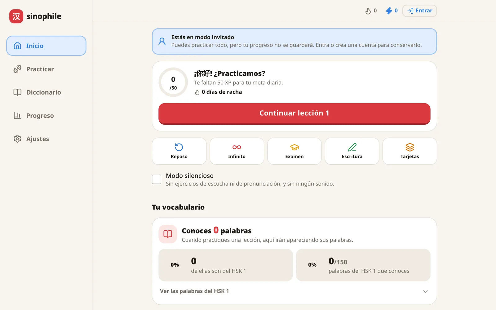
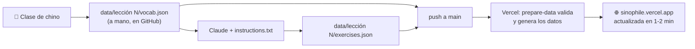
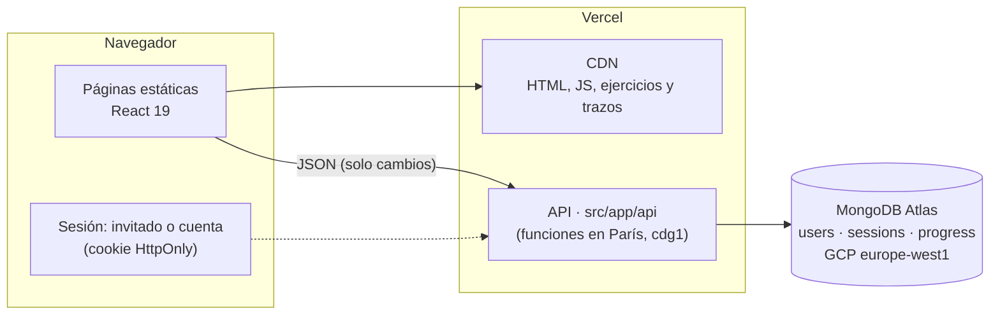
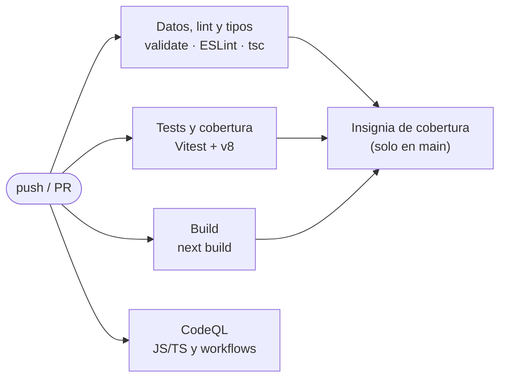

<div align="center">


# sinophile 汉

**App web para estudiar el vocabulario de chino mandarín que aprendo en clase**, al estilo de Duolingo
y Trainchinese.

[](https://github.com/Pablo-Caballero-Maria/sinophile/actions/workflows/ci.yml)
[](https://github.com/Pablo-Caballero-Maria/sinophile/actions/workflows/codeql.yml)
[](https://github.com/Pablo-Caballero-Maria/sinophile/actions/workflows/ci.yml)
[](https://github.com/Pablo-Caballero-Maria/sinophile/releases)
[](LICENSE)
[](https://sinophile.vercel.app)


[**Abrir la app**](https://sinophile.vercel.app) ·
[Wiki](https://github.com/Pablo-Caballero-Maria/sinophile/wiki) ·
[Registro de cambios](CHANGELOG.md) ·
[Resumen en mi portfolio](https://pablo-portfolio-woad.vercel.app/projects/sinophile)



</div>

Next.js desplegada en Vercel en cada *push* a `main`: las páginas son estáticas y una pequeña API guarda
las cuentas y el progreso en MongoDB Atlas.

> [!TIP]
> No hace falta cuenta para probarla: el **modo invitado** permite usarlo todo, aunque al cerrar la app
> no se guarda nada.

| 📚 Lecciones | 🈶 Palabras | ✍️ Tipos de ejercicio | 📖 Diccionario | ⏱️ De la clase a la web |
| :---: | :---: | :---: | :---: | :---: |
| 6 | 182 | más de 12 | CC-CEDICT (108 563 entradas) | 1-2 min |

## Índice

- [Flujo diario](#flujo-diario)
- [Funcionalidades](#funcionalidades)
- [Cómo está hecha](#cómo-está-hecha)
- [Datos (`data/`)](#datos-data)
- [Cuentas y progreso](#cuentas-y-progreso)
- [Desarrollo](#desarrollo)
- [Calidad e integración continua](#calidad-e-integración-continua)
- [Estructura](#estructura)
- [Documentación](#documentación)
- [Contribuir](#contribuir)
- [Cómo citar](#cómo-citar)
- [Licencia y créditos](#licencia-y-créditos)

## Flujo diario



1. Después de clase creo en GitHub la carpeta de esa clase, **`data/lección N/`** (`lección 1`,
   `lección 2`…), con su **`vocab.json`**:

   ```json
   [{ "id": "ni-hao", "hanzi": "你好", "pinyin": "nǐ hǎo", "es": "hola" }]
   ```

   Cada carpeta es una lección; el número del nombre marca el orden. Los `id` no se pueden repetir entre
   clases (solo letras sin tildes, números, `-` y `_`). Las palabras ya se pueden practicar con los
   ejercicios automáticos.
2. Le paso a Claude `instructions.txt`, el `vocab.json` de la clase nueva y los de las anteriores, y le
   pido el `exercises.json` de esa clase.
3. Lo guardo en **`data/lección N/exercises.json`**. En 1-2 minutos la web está actualizada.

> [!NOTE]
> Si algún JSON tiene errores, la app ignora lo inválido y lo muestra en **Ajustes → Estado de los
> datos**. Si el JSON ni siquiera es válido, el build falla y Vercel mantiene la versión anterior.

## Funcionalidades

- **Lecciones** con introducción de palabras nuevas, **repetición espaciada** (cajas de Leitner por
  palabra × destreza), repaso inteligente, modo infinito (3 vidas), exámenes con nota de 0 a 10 y
  tarjetas.
- **Ejercicios**: significado, español→chino, escucha, dictado de frases, pinyin y tonos (elegir y
  escribir), emparejar, rellenar huecos, traducir con fichas en ambas direcciones, diálogos, preguntas,
  pronunciación (reconocimiento de voz o grabación + comparación) y escritura de hanzi:
  - **guiada**, con el orden de trazos de Hanzi Writer;
  - **libre**, pensada para iPad + Apple Pencil: ves la palabra en español, la dibujas en un lienzo en
    blanco y se revela el hanzi, sin corrección, con la opción de repetirla o pasar a la siguiente; da XP
    pero no cuenta para la precisión ni para la repetición espaciada. La escritura de memoria de los
    exámenes sí se corrige trazo a trazo, porque el examen necesita una nota.
- **Modo silencioso**, para practicar rodeado de gente: una casilla en Inicio, Practicar y cada lección
  (también en Ajustes → Audio y voz) que quita los ejercicios de escucha y de pronunciación y apaga todos
  los sonidos. Los modos Escucha y Pronunciación desaparecen mientras está marcada, y se guarda con los
  ajustes de la cuenta.
- **Tu vocabulario** (en Inicio): cuántas palabras conoces, cuántas de ellas son del HSK 1 y qué parte
  del HSK 1 conoces ya, con la lista de sus 150 palabras (todas, conocidas o por aprender). Una palabra
  del HSK 1 cuenta como conocida si está en tus lecciones o dentro de otra que conoces (书 en 本书, 月 en
  一月; 杯 cuenta por 杯子).
- **Gamificación**: XP, niveles, racha diaria, meta diaria, combos, logros, estrellas por lección y
  récords.
- **Diccionario** (tu vocabulario + CC-CEDICT) con búsqueda por hanzi, pinyin con o sin tonos, español o
  inglés; traductor español ⇄ chino; ficha de palabra con trazos animados, ejemplos y dominio por
  destreza.
- **Colores por tono**, voz china (TTS del navegador), modo oscuro automático y diseño para móvil e iPad.

| Tono | 1.º | 2.º | 3.º | 4.º | neutro |
| --- | :---: | :---: | :---: | :---: | :---: |
| Color | 🔵 azul | 🟢 verde | 🟡 amarillo | 🔴 rojo | ⚪ gris |
| Ejemplo | mā | má | mǎ | mà | ma |

<p align="center">
  
  
</p>

## Cómo está hecha



La lógica vive en módulos de TypeScript sin React (repetición espaciada, pinyin con *erhua*, corrección
tolerante, puntuación de la escritura, voz, búsqueda en el diccionario, comparación con el HSK 1) y los
componentes solo la presentan. Más detalle en la wiki:
[Arquitectura](https://github.com/Pablo-Caballero-Maria/sinophile/wiki/Arquitectura).

## Datos (`data/`)

| Ruta | Quién lo escribe | Contenido |
| --- | --- | --- |
| `lección N/vocab.json` | yo, a mano | palabras de esa clase |
| `lección N/exercises.json` | Claude (ver `instructions.txt`) | notas, frases de ejemplo, huecos, traducciones, diálogos y preguntas por palabra |
| `cedict.json` | `npm run dictionary` | diccionario CC-CEDICT compacto (CC BY-SA 4.0) |
| `hsk1.json` | `npm run hsk` | las 150 palabras del HSK 1 (HSK 2.0), para el resumen de vocabulario del inicio |
| `instructions.txt` | — | instrucciones para que Claude escriba el `exercises.json` de una clase |

El formato completo de cada fichero está en la wiki: [Datos y lecciones](https://github.com/Pablo-Caballero-Maria/sinophile/wiki/Datos-y-lecciones).

## Cuentas y progreso

- **Modo invitado**: se puede usar todo sin cuenta, pero no se guarda nada (al cerrar la app se pierde).
- **Con cuenta** (`/cuenta`): el progreso (XP, rachas, repetición espaciada, exámenes, logros) y los
  ajustes se guardan en MongoDB y se comparten entre dispositivos. Al entrar o crear la cuenta se puede
  añadir lo practicado como invitado.
- El navegador no guarda datos de la app: solo la cookie de sesión (HttpOnly).
- **Ajustes → Copia de seguridad** permite exportar/importar `progress.json` y borrar el progreso.

### Base de datos

Variables de entorno (en local, en `.env.local`; en Vercel, en *Settings → Environment Variables*; ver
`.env.example`):

| Variable | |
| --- | --- |
| `MONGODB_URI` | cadena de conexión del clúster de Atlas (**secreta**) |
| `MONGODB_DB` | nombre de la base de datos (por defecto `sinophile`; en local uso `sinophile_dev`) |

Colecciones: `users` (credenciales con hash scrypt + ajustes), `sessions` (sesiones; solo se guarda el
SHA-256 del token de la cookie, caducan a los 180 días) y `progress` (un documento por cuenta). Los
cambios de progreso se envían en segundo plano y solo con lo que ha cambiado; el servidor los combina con
lo guardado (nunca se pierde lo hecho en otro dispositivo). Tras 10 contraseñas incorrectas seguidas la
cuenta se bloquea 15 minutos. Las funciones de Vercel corren en París (`vercel.json`), junto al clúster
(GCP europe-west1). En Atlas, *Network Access* debe permitir conexiones desde Vercel (IP dinámica:
`0.0.0.0/0`).

<details>
<summary><b>API</b> (<code>src/app/api/</code>)</summary>

| Método | Ruta | Para qué |
| --- | --- | --- |
| `GET` · `DELETE` | `/api/account` | la cuenta de la sesión; borrarla |
| `POST` | `/api/auth/register` | crear una cuenta |
| `POST` | `/api/auth/login` | iniciar sesión |
| `POST` | `/api/auth/logout` | cerrar la sesión |
| `POST` · `DELETE` | `/api/progress` | enviar cambios del progreso; borrarlo |
| `PUT` | `/api/settings` | guardar los ajustes |

Todas las peticiones que cambian algo deben ser JSON (defensa CSRF). Más en la wiki:
[API y cuentas](https://github.com/Pablo-Caballero-Maria/sinophile/wiki/API-y-cuentas).

</details>

## Desarrollo

Requiere **Node.js 24**.

```bash
npm install
cp .env.example .env.local   # y rellena MONGODB_URI
npm run dev                  # http://localhost:3000
npm run validate             # valida todas las carpetas de data/
npm run build && npm start
```

| Orden | Qué hace |
| --- | --- |
| `npm run dev` | servidor de desarrollo |
| `npm test` | tests (Vitest): datos, lógica y la API contra un MongoDB en memoria |
| `npm run test:coverage` | los mismos tests, con cobertura (`coverage/`) |
| `npm run lint` · `npm run typecheck` | ESLint · TypeScript |
| `npm run validate` | valida todas las carpetas de `data/` |
| `npm run dictionary` · `npm run hsk` | regeneran `data/cedict.json` · `data/hsk1.json` |

`scripts/prepare-data.ts` se ejecuta antes de `dev`, `build`, `test` y `typecheck`: valida los datos y
genera `src/generated/lessons.json` (todo el vocabulario, que va dentro del JavaScript),
`public/data/exercises.json` (los ejercicios de todas las clases, que se descargan al usarlos) y los
trazos de cada carácter usado (paquete `hanzi-writer-data`) en `public/strokes/`. Los tests de la API
descargan un `mongod` la primera vez.

## Calidad e integración continua

Cada *push* y *pull request* pasa por [GitHub Actions](https://github.com/Pablo-Caballero-Maria/sinophile/actions):



| Comprobación | Herramienta | Dónde |
| --- | --- | --- |
| Datos de las lecciones | `scripts/prepare-data.ts --check` | [ci.yml](.github/workflows/ci.yml) |
| Lint y tipos | ESLint (Next.js) y TypeScript estricto | [ci.yml](.github/workflows/ci.yml) |
| Tests unitarios y de integración (API + MongoDB en memoria) | Vitest, cobertura v8 | [ci.yml](.github/workflows/ci.yml) |
| Build de producción | Next.js | [ci.yml](.github/workflows/ci.yml) |
| Análisis de seguridad | CodeQL | [codeql.yml](.github/workflows/codeql.yml) |
| Dependencias | Dependabot (npm y Actions) | [dependabot.yml](.github/dependabot.yml) |
| Secretos | escaneo de secretos con protección al hacer *push* | ajustes del repositorio |

## Estructura

```
scripts/          prepare-data (genera los datos), data-files (lee data/), diccionario, iconos
src/
  app/            páginas: inicio, leccion, practicar, sesion, diccionario, palabra, progreso, ajustes, cuenta
  app/api/        rutas de la API (cuentas, progreso, ajustes)
  server/         MongoDB, contraseñas y sesiones, operaciones de cuenta (solo servidor)
  components/     UI (ui.tsx), hanzi (hanzi.tsx), lienzo, ejercicios/, sesión/
  lib/
    account/      sesión en el navegador (invitado / cuenta), guardado en segundo plano, llamadas a la API
    data/         carga + validación de las lecciones
    exercises/    tipos, generador de sesiones, corrección, máquina de estados de la sesión, modo silencioso
    progress/     modelo de progreso (XP, rachas, dominio, combinación), logros, store en memoria
    settings/     ajustes (modelo + store en memoria)
    pinyin.ts     tonos, comparación tolerante, división en sílabas (con erhua)
    srs.ts        repetición espaciada
    drawing.ts    dibujo a mano: corrección (exámenes) y conversión de trazos a SVG
    speech.ts     voz (TTS) y reconocimiento
    dictionary.ts búsqueda
    hsk.ts        comparación del vocabulario con la lista del HSK 1
docs/img/         capturas del README
```

## Documentación

La [wiki](https://github.com/Pablo-Caballero-Maria/sinophile/wiki) explica el proyecto con más detalle:

| Página | Contenido |
| --- | --- |
| [Arquitectura](https://github.com/Pablo-Caballero-Maria/sinophile/wiki/Arquitectura) | páginas estáticas, API, datos generados y despliegue |
| [Datos y lecciones](https://github.com/Pablo-Caballero-Maria/sinophile/wiki/Datos-y-lecciones) | formato de `vocab.json` y `exercises.json`, validación y cómo añadir una clase |
| [Aprendizaje y ejercicios](https://github.com/Pablo-Caballero-Maria/sinophile/wiki/Aprendizaje-y-ejercicios) | repetición espaciada, sesiones, corrección, escritura y voz |
| [API y cuentas](https://github.com/Pablo-Caballero-Maria/sinophile/wiki/API-y-cuentas) | rutas, sesiones, contraseñas, sincronización del progreso |
| [Desarrollo y pruebas](https://github.com/Pablo-Caballero-Maria/sinophile/wiki/Desarrollo-y-pruebas) | entorno local, tests, cobertura, CI y publicación de versiones |
| [Preguntas frecuentes](https://github.com/Pablo-Caballero-Maria/sinophile/wiki/Preguntas-frecuentes) | dudas habituales |

## Contribuir

Las propuestas y correcciones son bienvenidas:

- Abre un *issue* con la plantilla adecuada: [error](https://github.com/Pablo-Caballero-Maria/sinophile/issues/new?template=bug_report.yml),
  [mejora](https://github.com/Pablo-Caballero-Maria/sinophile/issues/new?template=feature_request.yml) o
  [error en el vocabulario o en un ejercicio](https://github.com/Pablo-Caballero-Maria/sinophile/issues/new?template=error_en_datos.yml).
- Los *pull requests* siguen la [plantilla](.github/pull_request_template.md) y tienen que pasar la CI.
- Toda la participación se rige por el [código de conducta](CODE_OF_CONDUCT.md).
- Los problemas de seguridad se informan en privado, como explica [SECURITY.md](SECURITY.md).

## Cómo citar

Si usas sinophile en un trabajo, cítalo con los metadatos de [CITATION.cff](CITATION.cff) (GitHub ofrece
*Cite this repository* en la barra lateral).

<details>
<summary>BibTeX</summary>

```bibtex
@software{caballero_maria_sinophile_2026,
  author  = {Caballero María, Pablo},
  title   = {sinophile: app web para estudiar vocabulario de chino mandarín},
  year    = {2026},
  version = {1.0.0},
  url     = {https://github.com/Pablo-Caballero-Maria/sinophile},
  license = {MIT}
}
```

</details>

## Licencia y créditos

El código está bajo la [licencia MIT](LICENSE). Los datos de terceros conservan sus licencias:
CC-CEDICT (CC BY-SA 4.0), Make Me a Hanzi / hanzi-writer-data (Arphic Public License), Hanzi Writer
(MIT), pinyin-pro (MIT) y la lista del HSK 1 de complete-hsk-vocabulary (MIT).
